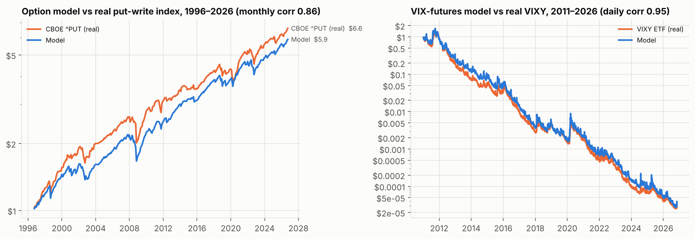
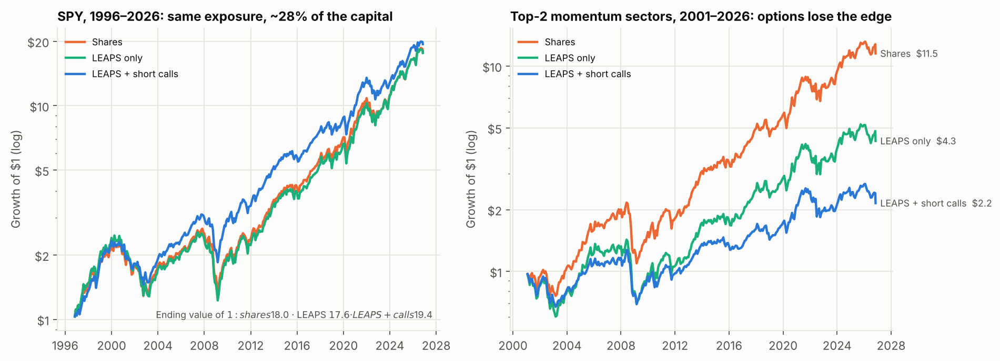
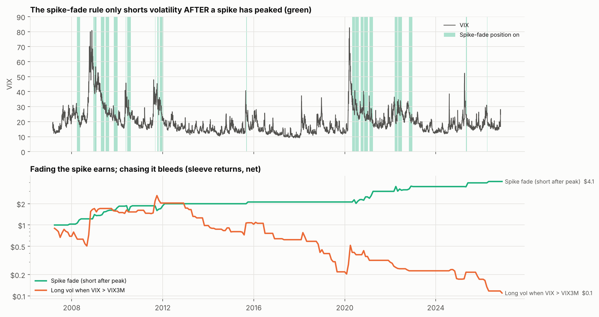
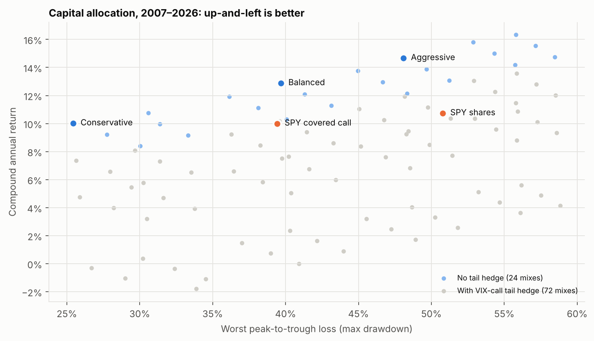
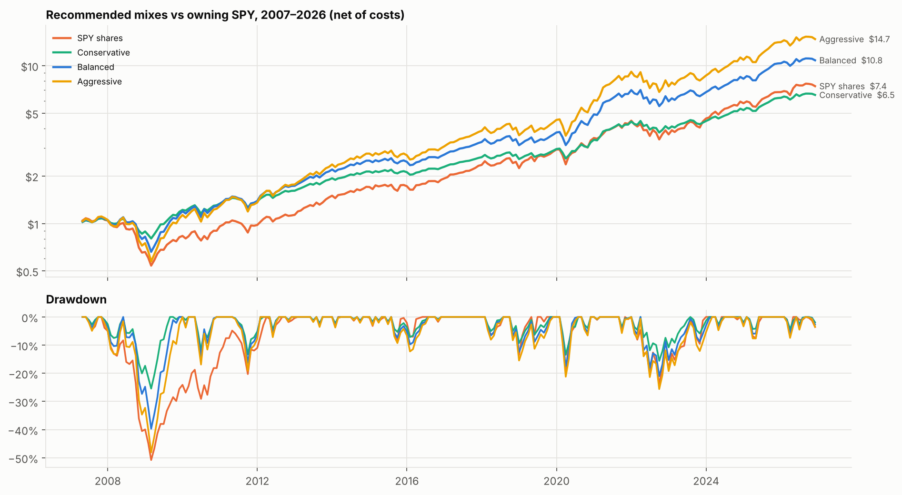

# LEAPS Income and VIX Spike Trading: Risk and Capital-Allocation Efficiency

**Research paper.** Backtests run on free data and net of trading costs: SPY 1996–2026, sector ETFs 2001–2026, VIX sleeves 2007–2026.

> Not investment advice. Options prices here are *modelled* (calibrated to real indices), not historical quotes. Read §8 before acting on anything.

---

## Abstract

We test two additions to the momentum program in `research/momentum`:
1. **The LEAPS edge:** replace stock with deep-in-the-money long-dated calls (LEAPS) and sell short-dated calls above them for income.
2. **The VIX spike trade:** profit from volatility spikes.

We then ask how to split capital between them.

Free historical option quotes don't exist, so options are priced with Black-Scholes / Black-76 on a volatility surface built from VIX, VIX3M and VVIX. It is calibrated against two real tradable records:
- The CBOE PutWrite index (model 8.83%/yr vs actual 8.82%/yr, 1996–2026).
- The VIXY ETF (daily correlation 0.95, decay matched, 2011–2026).

Main results:
- **LEAPS deliver real capital efficiency on SPY.** The same market exposure as owning shares needs only **~28% of the capital**, and the same 10.0%/yr return. The other 72% is free for T-bills or other strategies.
- **Selling calls above the LEAPS cuts risk; it doesn't add return.** It brings in about 9%/yr of premium as cash, but rallies take nearly all of it back (payouts about 9.4%/yr). The real benefit is a smoother ride: volatility 15.7%→12.7%, Sharpe 0.59→0.71, max drawdown −52%→−40%.
- **On rotating momentum sectors, LEAPS and call-selling both fail.** LEAPS turnover (4.5 rolls a year) costs 3.8%/yr in spreads. Selling calls on sectors that are trending up pays out 2.5–3%/yr more than it collects. **Keep the momentum tilt in shares, and run LEAPS income on the index.**
- **For VIX, the money is in fading the spike, not chasing it.**
  - Shorting volatility only *after* a spike has peaked earned **+7.5%/yr at a Sharpe of 0.61** (real-ETF check, 2011+: +7.7%, Sharpe 0.59). It sat out the February 2018 short-volatility blow-up.
  - Buying volatility after the VIX term structure inverts lost money.
  - Monthly OTM VIX calls returned only **6–17 cents per premium dollar**. They are insurance, not a strategy.
- **Combined, three portfolios stand out (2007–2026):**
  - *Conservative:* matches SPY's return (10.0% vs 10.7%) with **half its drawdown** (−25% vs −51%).
  - *Balanced:* adds **+2.2%/yr** over SPY (12.9%) with a smaller drawdown (−40%).
  - *Aggressive:* earns **14.7%/yr** with SPY-like drawdown (−48%).
- **Paying for VIX-call tail hedges made every allocation worse.**
- **Goal: higher Sharpe and 25%+** (§5.7): combining eight sleeves with risk balanced across four groups raised the Sharpe to about **1.0** before leverage.
  - With hard limits on each sleeve, levering to a 40% volatility target made **24.3%/yr** (2008–2026), and 23.7%/yr on the untouched 2017–2026 test half. Worst drawdown −35%; SPY made 11.9% and QQQ 17.5%.
  - The unlimited version reached 26.9% but could lose up to 72% in a single VIX-shock day.
  - **Selling put spreads to buy calls for free** worked well on QQQ: Sharpe 0.81 per dollar of exposure, with no net premium.
- **Growth leadership** (§5.6): rotating among QQQ, mid caps, small caps, semis, software and the sectors beat SPY by 3.5%/yr (2002–2026). Selling calls on QQQ loses money; hold QQQ LEAPS without calls. A 50/50 SPY/QQQ core plus two long/short sleeves made 17.6–19.2%/yr in 2007–2026, against 16.6% for QQQ. Over 2000–2026 that same core did no better than SPY and fell 68%.
- **The long/short momentum sleeve with a 50-day moving-average tilt** (§5.5) adds little on its own since 1996.
  - With 10 stocks per side, a fair test (only stocks already in the S&P 500 at each date) loses money in every version. A biased test using today's index members makes the same rule look like +10%/yr.
  - On survivorship-free CRSP portfolios, tilting toward longs above the 50-day average was a huge edge before 1996 (Sharpe 0.39 → 0.84). Since 1996 it's small (0.20 → 0.27).
  - Inside the mix, a **20% market-neutral momentum sleeve** improved all three portfolios (Balanced: Sharpe 0.80 → 0.89, max drawdown −40% → −37%). The tilted version helped only with a 1% band.

---

## 1. Questions

1. Does buying LEAPS instead of shares, and selling calls above them ("poor man's covered call", PMCC), improve return per dollar of capital and per unit of risk?
2. Does it work on the momentum-selected sectors from the earlier study, or only on the index?
3. Which ways of trading VIX spikes actually make money after costs?
4. How should capital be split between the LEAPS book, the VIX sleeves and cash? How much leverage is sensible?

---

## 2. Data and the option-pricing model

### 2.1 Data (all free, Yahoo Finance + Ken French library)
| Series | Span | Use |
|---|---|---|
| SPY and 11 SPDR sector ETFs, raw and dividend-adjusted | 1993/1998 → 2026-11 | Underlyings. The raw vs adjusted gap gives each fund's dividend yield. |
| ^VIX | 1990 → | 30-day implied-volatility level, and spike signals |
| ^VIX3M | 2006 → | Term structure (inverted vs normal) |
| ^VVIX | 2007 → | Volatility of VIX (implied vol for VIX options) |
| ^PUT (CBOE S&P 500 PutWrite index) | 1996 → | **Real** option-selling record, used for calibration |
| VIXY, SVXY | 2011 → | **Real** VIX-futures funds, used for validation |
| Fama-French daily risk-free rate | 1926 → | T-bill rate |

### 2.2 Volatility surface
| Component | Formula | How it was set |
|---|---|---|
| ATM 1-month IV (SPY) | `A × VIX` | **A = 0.82**, fitted so a simulated monthly ATM S&P put-write matches CBOE ^PUT: 8.83%/yr vs 8.82%/yr, monthly correlation 0.86 |
| Term structure | `θ + (iv₃₀ − θ)·g(T)/g(1/12)`, with `g(T) = (1−e^{−kT})/(kT)` | θ = long-run average 3-month IV (17.4% ATM); **k = 3.0/yr** fitted to VIX→VIX3M (R² 0.92) |
| Skew | `iv_atm − 0.15·ln(K/F)/√T` | Typical index skew. Deep-ITM LEAPS carry more vol than ATM, and OTM calls less. |
| Sector ETFs | SPY surface × (sector/SPY realized-vol ratio), blending from the 63-day ratio toward the 2-year ratio for long maturities | Long-dated options price vol mean-reversion |
| VIX futures | √(forward variance over the 30 days after expiry) from VIX/VIX3M, minus a convexity term, with the premium over spot scaled by **κ = 0.6** | κ fitted so the modelled 30-day constant-maturity futures decay matches VIXY: −64.6%/yr vs −65.4%/yr, daily correlation 0.95 |
| VIX options | Black-76 on that future, IV = VVIX × (1 + 0.4·ln(K/F)) | VIX smile slopes upward |

The resulting 18-month LEAPS IV is about 15.5% when VIX is 12, 17% at VIX 20 and 22% at VIX 45. That is realistic for SPY.



The model put-write ends at $5.9 against the real index's $6.6 over 30 years. The model is slightly conservative, mostly because monthly timing differs from CBOE's third-Friday rolls.

### 2.3 Trading costs
| Instrument | Half bid-ask (of option price) | Minimum | Commission |
|---|---|---|---|
| SPY 1-month calls | 2% | $0.01 | $0.65/contract |
| SPY LEAPS | 1% | $0.05 | $0.65/contract |
| Sector 1-month calls | 4% (2.5% "patient") | $0.02 | $0.65/contract |
| Sector LEAPS | 2.5% (1.2% "patient") | $0.10 | $0.65/contract |
| VIX options | 5% | $0.03 | — |

---

## 3. The LEAPS income engine

### 3.1 Mechanics (checked every month end)
1. **Buy LEAPS** at **0.80 delta**, **1.5 years** out, sized so `contracts × delta × price = λ × account value`. With λ = 1, the market exposure equals owning shares.
2. **Roll** when 6 months remain, when delta leaves 0.60–0.97, or when exposure drifts more than ±33% from target.
3. **Sell one 1-month 0.25-delta call per LEAPS.** It expires or is settled at intrinsic value at the next month end.
4. **Keep all unspent cash in T-bills.** No borrowing to buy LEAPS.

### 3.2 SPY results, Oct 1996 → Oct 2026 (30 years)
| Strategy | CAGR | Vol | Sharpe | Sortino | Max DD | CVaR 5% (monthly) | Capital in options | Call premium /yr | Call payouts /yr |
|---|---|---|---|---|---|---|---|---|---|
| Shares (buy & hold) | 10.0% | 15.3% | 0.60 | 0.85 | −51% | −9.6% | — | — | — |
| Covered call (shares + calls) | 9.7% | 12.0% | 0.70 | 0.88 | −36% | −8.1% | — | 6.9% | 7.1% |
| **LEAPS only** | **10.0%** | 15.7% | 0.59 | 0.91 | −52% | −9.1% | **28%** | — | — |
| **LEAPS + short calls** | **10.3%** | **12.7%** | **0.71** | **0.95** | **−40%** | −8.2% | 28% | 9.2% | 9.4% |
| LEAPS + calls, paused in spikes | 9.8% | 13.4% | 0.65 | 0.86 | −46% | −8.8% | 28% | 7.4% | 8.0% |



**What this means:**
* **Capital efficiency is the real LEAPS edge.** About 28 cents of LEAPS does the work of $1 of stock: the same return, and only slightly higher volatility. The other 72 cents can earn T-bill interest (included above) or fund the VIX sleeves in §5. LEAPS also cap the loss on that 28 cents. In a crash you can't lose more than the premium paid.
* **The "income stream" is real cash flow, but not free money.** Selling calls brings in about 0.75%/month of premium. In rallies you pay most of it back (call payouts ≈ premium). What you keep is **lower risk**: −12 points of max drawdown and +0.12 Sharpe. Treat call income as a **volatility dampener**, not extra yield.
* **Don't pause call-selling during VIX spikes.** It *lowered* the Sharpe from 0.71 to 0.65. Right after spikes, call premiums are at their richest, and that is exactly when selling pays best. (The spike *buy* signal belongs in the allocation layer, §5.)

### 3.3 Parameter sensitivity (SPY, 54-cell grid, averages)
| Setting | Options | Effect |
|---|---|---|
| LEAPS delta | 0.70 / **0.80** / 0.90 | Sharpe 0.66 / **0.68** / 0.62. 0.90 is too deep: it ties up capital and rolls more. |
| LEAPS tenor | 1.0 / 1.5 / **2.0** years | Sharpe 0.63 / 0.66 / 0.66. Longer LEAPS mean fewer rolls and less time decay per month. |
| Short-call delta | 0.15 / **0.25** / 0.35 | CAGR 10.3% / 9.8% / 8.6%; max DD −48% / −44% / −40%. More income means more upside given away. |
| Exposure λ | 0.5 / 1.0 / 1.5 / 2.0 | CAGR 6.4% / 9.8% / 12.6% / 14.6%; max DD −24% / −46% / −63% / −76% (paused-calls variant) |

Best single cell: 0.80 delta, 2-year LEAPS, 0.25-delta calls, Sharpe 0.74, CAGR 10.8%, DD −40%. The a priori default (1.5 years) is within noise of it.

### 3.4 Momentum sectors (top-2 SPDR by SPSR, 2001 → 2026)
| Strategy | CAGR | Sharpe | Max DD | LEAPS rolls/yr | Spread cost /yr | Call premium − payouts |
|---|---|---|---|---|---|---|
| Shares (the momentum tilt) | **9.9%** | **0.56** | −49% | — | — | — |
| Covered call on shares | 7.9% | 0.51 | −43% | — | 1.3% | **−2.6%** |
| LEAPS only | 5.8% | 0.33 | −51% | 4.5 | 3.8% | — |
| LEAPS + calls | 3.0% | 0.19 | −45% | 4.5 | 5.4% | **−3.1%** |
| LEAPS only, patient limit orders | 7.8% | 0.44 | −51% | 4.4 | 1.9% | — |
| Quarterly rotation + wider buffer (shares) | 8.4% | 0.49 | −47% | — | — | — |

Two separate failures:
1. **Turnover.** Momentum rotates sectors about 4–5 times a year per slot. Each LEAPS round trip costs about 1.5% of notional. Even patient execution leaves LEAPS 2%/yr behind shares.
2. **Selling calls on winners.** Momentum picks sectors whose returns are expected to keep beating the market, so their calls end in the money more often than option prices assume. Every sector call-selling variant **paid out more than it collected**. Selling upside on a momentum position cancels out the reason you bought it.

**Design conclusion:** run **LEAPS + call income on the broad index (SPY)**, and hold the **momentum tilt in shares**, with no calls sold on it.

---

## 4. VIX spike strategies (daily, Mar 2007 → Nov 2026)

| Sleeve | Rule | CAGR | Vol | Sharpe | Max DD | Time active |
|---|---|---|---|---|---|---|
| V0 always long VIX futures | Hold a 30-day constant-maturity future | −41% | 86% | −0.21 | −100% | 100% |
| ↳ real VIXY, 2011+ | | −48% | 70% | −0.60 | −100% | |
| V1 long vol in backwardation | Long only while VIX ≥ VIX3M | −10.6% | 48% | −0.01 | −96% | 11% |
| ↳ real VIXY, 2011+ | | −2.5% | 36% | 0.10 | −75% | |
| **V3 spike fade (0.5× short)** | VIX ≥ 25, term structure back in contango, VIX ≥ 15% below its 10-day high. Exit when VIX < 18, after 40 days, or if backwardation returns | **+7.5%** | 13% | **0.61** | **−22%** | 12% |
| ↳ real SVXY, 2011+ | | **+7.7%** | 15% | **0.59** | −25% | |

**OTM VIX calls** (bought monthly, about 60 days out, sell everything once worth 3–5× cost or hold to expiry):

| Strike / future | Take profit | $ back per $1 premium | Months that paid | Best month |
|---|---|---|---|---|
| 1.3× | 5× | **$0.17** | 4.7% | 6.9× |
| 1.6× | 5× | $0.09 | 1.7% | 6.7× |
| 2.0× | 5× | $0.07 | 1.3% | 7.6× |



**What this means:**
* **Buying the spike rarely pays.** By the time VIX is visibly spiking (term structure inverted), futures already price it in, and the decay resumes as soon as fear fades. Permanent long volatility loses 40–50% a year.
* **Fading the spike works.** After the peak, implied vol and futures premiums collapse toward normal, and a *short* position collects that move. The rule waits for three confirmations (still elevated, term structure normal again, already 15% off the high). Because of that, it **never shorted into a rising spike**: it was flat through February 2018 and February–March 2020, and entered afterwards. Its worst month was −17.5% (June 2010). It made +36% in 2008 and +17–20% a year in 2020–2022.
* **VIX calls are insurance with a 83–93% average premium loss.** They pay off hugely in crashes: over 2008 and 2020 they returned about 14× and 7× one month's budget. But spending even 0.25% of the account per month costs more than the protection is worth (§5). This matches Israelov's "Pathetic Protection" finding for index puts.

---

## 5. Capital allocation and risk (2007-04 → 2026-10)

### 5.1 The building blocks
* **Core:** SPY LEAPS + 0.25-delta calls at exposure λ ∈ {0.75, 1.0, 1.25, 1.5}. Spare cash in T-bills.
* **Fade:** the V3 spike-fade sleeve at weight 0, 10% or 20% of the account. It is funded from the T-bill cash the LEAPS free up, so this is where capital efficiency gets spent.
* **Boost ("buy the spike"):** while the V3 "spike over" signal is on at a month end, run the core at λ + 0.5 for the next month.
* **Tail:** OTM VIX calls costing 0, 0.25%, 0.5% or 1% of the account per month.

That gives 96 combinations.

### 5.2 Results
| Portfolio | CAGR | Vol | Sharpe | Max DD | Calmar | CVaR 5% | Worst month | 2008 | 2020 | 2022 | Capital in options |
|---|---|---|---|---|---|---|---|---|---|---|---|
| SPY shares | 10.7% | 15.4% | 0.64 | −51% | 0.21 | −9.7% | — | −36.8% | +18.3% | −18.2% | — |
| SPY covered call | 10.0% | 12.4% | 0.71 | −39% | 0.25 | −8.5% | — | −27.5% | +15.8% | −18.4% | — |
| Core λ=1 (LEAPS + calls) | 10.3% | 12.7% | 0.72 | −40% | 0.26 | −8.2% | −14.5% | −28.4% | +13.8% | −17.1% | 29% |
| **Conservative:** λ 0.75 + 20% fade | 10.0% | 10.5% | **0.82** | **−25%** | **0.39** | **−6.5%** | **−8.2%** | **−15.2%** | +14.4% | **−9.9%** | 22% |
| **Balanced:** λ 1.0 + 20% fade + boost | **12.9%** | 15.0% | 0.78 | −40% | 0.32 | −9.6% | −14.5% | −21.6% | **+30.2%** | −15.2% | 29% |
| **Aggressive:** λ 1.25 + 20% fade + boost | **14.7%** | 17.9% | 0.77 | −48% | 0.31 | −11.6% | −18.2% | −28.8% | +33.4% | −19.2% | 35% |
| λ 1.5, no VIX sleeves | 14.2% | 18.7% | 0.73 | −56% | 0.25 | −12.2% | −21.9% | −41.3% | +20.2% | −21.2% | 42% |




### 5.3 What each sleeve does (average over all other settings)
| Sleeve | Setting | Avg CAGR | Avg Sharpe | Avg Max DD |
|---|---|---|---|---|
| Spike fade | 0% → 10% → 20% | 7.1% → 7.8% → 8.6% | 0.42 → 0.46 → 0.50 | −45% → −44% → −42% |
| Buy-the-spike boost | off → on | 7.4% → 8.2% | 0.45 → 0.47 | −42% → −45% |
| **VIX-call tail hedge** | 0 → 0.25% → 0.5% → 1%/month | **12.5% → 9.8% → 7.1% → 2.0%** | 0.75 → 0.59 → 0.42 → 0.06 | −43% → −43% → −44% → −44% |
| Core exposure λ | 0.75 → 1.0 → 1.25 → 1.5 | 5.0% → 7.0% → 8.8% → 10.6% | 0.36 → 0.45 → 0.49 → 0.53 | −30% → −40% → −48% → −56% |

* **The fade sleeve is the best use of the capital LEAPS free up.** It adds return *and* reduces drawdown, because it earns in the recovery right after the core's worst months.
* **The boost adds return in rebounds** (2020: +30% vs +14%), for a modestly deeper drawdown.
* **Tail hedging with VIX calls never paid for itself.** Every budget level lowered return and Sharpe and **did not reduce max drawdown at all**. The 2008 drawdown builds over months, and monthly calls mostly expire worthless between spikes.

### 5.4 How much leverage? (Kelly and drawdown budgets)
Growth rate (mean log return) of the core keeps rising with λ through 2.0 in 2007–2026: 6.3% at 0.5, 9.8% at 1.0, 13.3% at 1.5, 15.9% at 2.0. So the formal "Kelly" answer is above 2×. **We don't recommend acting on it.**
- The estimate comes from one strong bull era.
- In the 30-year SPY test, λ = 2 had an **−76% to −88%** drawdown (1999–2002 + 2008).
- Kelly sizing assumes you know the true return, and you don't.

The standard practice is **half-Kelly or less**, with a **drawdown budget** on top. Choose λ so the stress-test drawdown is one you would actually sit through:

| Drawdown you can tolerate | Suggested setting |
|---|---|
| ~25% | Conservative: λ 0.75 + fade |
| ~40% (covered-call-like) | Balanced: λ 1.0 + fade + boost |
| ~50% (stock-market-like) | Aggressive: λ 1.25 + fade + boost |
| > 55% | Not recommended |

---

### 5.5 Long/short momentum sleeve with a 50-day moving-average tilt

**The rule.** Each month end, long 10 and short 10 stocks by 6-1 momentum: the 6-month return, skipping the latest month. In the *concentrated* version, longs come only from the 3 strongest GICS sectors and shorts from the 3 weakest, rated by 9-month SPSR. Every day, compare SPY's close with its 50-day simple moving average, and set the next day's leg weights:

| Tilt | SPY above its 50-day average | SPY below it |
|---|---|---|
| neutral | 100% long / 100% short | 100 / 100 |
| tilt130 | 130 / 70 | 70 / 130 |
| **tilt150 (requested)** | **150 / 50** | **50 / 150** |
| flip | 100 / 0 | 0 / 100 |

Each tilt was also run with a **1% band**: the regime only changes once SPY is more than 1% beyond its average. That cuts regime switches from 18 to 7 a year.

Costs:
- 10 bps per unit of stock turnover.
- 0.5%/yr borrow fee on shorts.
- T-bill interest only on idle cash, with nothing credited on short-sale proceeds.

**Test 1: 10/10 stocks, S&P 500 (1996-10 → 2026-10).** Free data only lists *today's* members.

| Version | CAGR | Vol | Sharpe | Max DD |
|---|---|---|---|---|
| **Biased: today's members at every date (look-ahead)** | | | | |
| ↳ long-only top 10 | 48.6% | 34% | 1.26 | −66% |
| ↳ tilt150 | +10.4% | 53% | 0.41 | −98% |
| **Fairer: only stocks already in the index on each date** | | | | |
| ↳ neutral | −6.3% | 36% | −0.07 | −98% |
| ↳ tilt150 | −9.0% | 47% | −0.01 | −99% |
| ↳ tilt150, 1% band | −7.4% | 47% | 0.03 | −99% |
| ↳ flip, 1% band (best) | −1.9% | 34% | 0.05 | −87% |
| ↳ concentrated tilt150 | −16.3% | 48% | −0.18 | −100% |
| SPY ±1 by its 50-day average (timing only) | −2.3% | 19% | −0.14 | −72% |
| SPY buy & hold | 10.2% | 19% | 0.48 | −55% |

The biased version picks companies that became index members *because* they soared (Carvana, AppLovin, Bloom Energy and others), so it effectively knows the future. The fairer version still leaves out companies that were later dropped or went bust. That removes failed shorts, but also failed longs, so even it is not a clean test. **With only 10 names per side, volatility is 34–48% and drawdowns approach −100% either way.**

**Test 2: survivorship-free CRSP momentum deciles (Ken French, daily).** Long the top 10% by 12-2 momentum, short the bottom 10%, with every NYSE/AMEX/NASDAQ stock included and dead companies kept. The regime comes from the whole market's 50-day average. Costs also include about 35% monthly turnover inside each decile.

| Version | 1927–1996 CAGR | Sharpe | 1996–2026 CAGR | Sharpe | Max DD (1996–2026) |
|---|---|---|---|---|---|
| neutral | 9.5% | 0.39 | 3.6% | 0.20 | −84% |
| tilt130 | 19.8% | 0.76 | 4.7% | 0.25 | −92% |
| **tilt150** | **26.1%** | **0.84** | **3.8%** | **0.26** | −96% |
| tilt150, 1% band | 22.1% | 0.73 | 4.4% | 0.27 | −92% |
| flip | 22.0% | 0.83 | 4.2% | 0.22 | −87% |
| flip, 1% band | 18.1% | 0.69 | 4.9% | 0.24 | −77% |
| Market ±1 by its 50-day average | 15.1% | 0.75 | 0.4% | 0.00 | −62% |
| Market buy & hold | 9.5% | 0.43 | 10.4% | 0.49 | −55% |

Moving-average length (tilt150, Sharpe):

| Average length | 20 days | **50 days** | 100 days | 200 days |
|---|---|---|---|---|
| 1927–1996 | 0.93 | 0.84 | 0.74 | 0.62 |
| 1996–2026 | 0.23 | 0.26 | 0.26 | 0.22 |

**What this means:**
* **The idea is real but has faded.** For 70 years, overweighting momentum winners in uptrends and losers in downtrends roughly doubled the Sharpe of momentum. Since 1996 the edge is about +0.06 Sharpe. The underlying cause is that simple 50-day trend timing of the market stopped working after the mid-1990s (Sharpe 0.75 → 0.00).
* **50 days is a sensible length.** 50–100 days is the best range in the recent era, and shorter averages won earlier.
* **The 1% band helps.** It cuts whipsaw trades by 60% and slightly improves the recent-era results.
* **Ten stocks per side is too few.** Concentration multiplies single-stock risk without adding return.

**Adding the sleeve to the mix (2007-04 → 2026-09).** The sleeve uses the honest CRSP version, funded from the mix's T-bill cash at 20% of the account.

| Mix | Sleeve | CAGR | Sharpe | Max DD | 2008 | 2022 |
|---|---|---|---|---|---|---|
| Conservative | none | 10.2% | 0.83 | −25.4% | −15.2% | −9.9% |
| Conservative | **neutral momentum** | **10.9%** | **0.91** | **−22.2%** | −11.9% | −5.7% |
| Conservative | tilt150, 1% band | 10.9% | 0.85 | −24.8% | −10.3% | −11.5% |
| Balanced | none | 13.1% | 0.80 | −39.7% | −21.6% | −15.2% |
| Balanced | **neutral momentum** | **14.0%** | **0.89** | **−36.9%** | −18.4% | −11.0% |
| Balanced | tilt150 | 13.2% | 0.81 | −40.0% | −20.2% | −16.8% |
| Balanced | tilt150, 1% band | 13.9% | 0.86 | −37.5% | −16.7% | −16.5% |
| Balanced | flip, 1% band | 13.7% | 0.84 | −35.4% | −16.0% | −17.7% |
| Aggressive | none | 15.0% | 0.79 | −48.1% | −28.8% | −19.2% |
| Aggressive | **neutral momentum** | **15.9%** | **0.87** | **−44.7%** | −25.8% | −15.2% |
| Aggressive | tilt150, 1% band | 15.9% | 0.85 | −43.9% | −24.2% | −20.3% |

The mix is already long the market through the LEAPS core. So the **market-neutral** momentum sleeve is the better diversifier: it adds return and lowers drawdown in all three mixes. The 150/50 tilt adds more market exposure on top of a portfolio that already has plenty. Without the band it added nothing, and with the band it roughly matched the neutral sleeve. The tilt only paid in 2008, when shorts were overweight in the downtrend.

**Live state (2026-11-06):**
- SPY closed at 737.74, below its 50-day average of 765.73, so the tilt is **down**: overweight shorts.
- Current plain baskets: long CRL, CRWD, DELL, HPE, ILMN, MRNA, OKTA, PANW, RVTY, VEEV; short ALB, APP, CIEN, COHR, FIX, LII, NFLX, NRG, RDDT, ROL.

These lists come from the stock-level test that §5.5 shows lost money. Treat them as a scan, not a trade list.

### 5.6 Growth leadership: QQQ, mid and small caps, the leading sectors, Mag 7 and AI

The aim is to hold the leading parts of the market instead of the whole market. **Hindsight warning:** "Mag 7" and "AI leaders" are groups defined *after* they won. A 30-year backtest of them would pick the winners in advance. So the study has two parts:
1. A **rule-based** version that could have been run in real time, 2002–2026.
2. The **actual named basket**, tested only from January 2023, when the group was first identifiable.

**Part 1: rule-based leadership rotation (daily, 2002-08 → 2026-10).**
- **The menu:** QQQ, MDY (mid caps), IJR (small caps), SMH (semiconductors), IGV (software) and the SPDR sectors.
- **Monthly ranking:** blended SPSR (6/9/12-month windows, skip 1). Hold the top 3, keeping a holding while it ranks in the top 5.
- **The growth mix:** fixed buckets of 40% QQQ, 15% MDY, 10% IJR and 35% leadership rotation.

| Strategy | CAGR | Vol | Sharpe | Max DD | 2008 | 2022 |
|---|---|---|---|---|---|---|
| SPY | 11.1% | 18.7% | 0.57 | −55% | −36.8% | −18.2% |
| QQQ | 15.7% | 22.0% | 0.70 | −53% | −41.7% | −32.6% |
| MDY (mid caps) | 10.4% | 21.6% | 0.49 | −55% | −36.4% | −13.3% |
| IJR (small caps) | 10.7% | 22.9% | 0.48 | −58% | −31.5% | −16.2% |
| SMH (semis) | 17.1% | 31.3% | 0.61 | −68% | −45.7% | −33.5% |
| **Leadership rotation, top 3** | **14.6%** | 20.7% | **0.68** | −50% | −33.0% | −8.3% |
| ↳ with 50-day tilt (100% above / 50% below) | 11.1% | 15.3% | 0.65 | **−36%** | −20.9% | −8.6% |
| Growth mix (40/15/10/35) | 14.3% | 20.4% | 0.68 | −52% | −36.5% | −19.9% |
| ↳ with 50-day tilt | 11.0% | 14.9% | 0.66 | −37% | −23.3% | −19.4% |
| ↳ tilt + short bottom-3 below the average | 7.2% | 13.3% | 0.47 | −28% | −14.7% | −17.7% |
| Leadership L/S 150/50, 1% band (top 3 vs bottom 3) | −0.7% | 27.3% | 0.05 | −56% | +17.9% | −2.3% |

Most-held over 24 years:

| QQQ | SMH | XLK | XLY | XLE | XLV | MDY | IJR |
|---|---|---|---|---|---|---|---|
| 35% of months | 33% | 28% | 27% | 26% | 20% | 20% | 20% |

**Today's top 3: SMH, XLE, XLK.** SPY and QQQ are both below their 50-day averages.

* **Rotation picks up the leaders on its own.** It held QQQ or semis in about a third of all months, and mid/small caps when they led. It beat SPY by 3.5%/yr. It didn't beat QQQ over this tech-led period, but it cut 2022's loss from −33% to −8%.
* **Shorting the laggard ETFs doesn't pay.** Long/short versions earned about 0%. The edge is in *owning* leaders, not shorting laggards.
* **The 50-day tilt trades return for a smaller drawdown:** about −3.5%/yr of return for about −15 points of drawdown.

**Part 2: the named Mag 7 + AI basket (2023-01 → 2026-11, hindsight).**

| Basket, equal weight | CAGR | Sharpe | Max DD | 2023 | 2024 | 2025 | 2026 YTD |
|---|---|---|---|---|---|---|---|
| Mag 7 | 47.7% | 1.44 | −29% | +109% | +62% | +26% | +5% |
| AI leaders (NVDA, AVGO, AMD, TSM, ORCL, PLTR, ANET, MU, SMCI, ARM, VRT, CRWD, NOW, DELL) | 78.7% | 1.58 | −36% | +135% | +88% | +48% | +41% |
| Mag 7 + AI combined | 67.4% | 1.61 | −32% | +121% | +76% | +41% | +31% |
| ↳ with 50-day tilt | 54.6% | 1.58 | −24% | +98% | +58% | +44% | +18% |
| Top-5 momentum inside the group | 70.4% | 1.30 | −38% | +119% | +87% | +41% | +34% |
| QQQ | 27.2% | 1.05 | −23% | +55% | +26% | +21% | +7% |
| SMH | 49.2% | 1.16 | −36% | +73% | +39% | +49% | +29% |

These numbers describe **the period in which this group was the market's story**, so they are not a forecast. SMH, a rule-based ETF anyone could have bought, captured most of the AI move (+49%/yr) without picking names. For a forward-looking sleeve, use the top-5 momentum rule inside a *broad* growth list that you refresh each year, rather than a frozen list of today's winners.

**Part 3: LEAPS + calls on QQQ (2000-01 → 2026-10).**

| QQQ | CAGR | Sharpe | Max DD | Call premium /yr | Call payouts /yr |
|---|---|---|---|---|---|
| Shares | 8.3% | 0.47 | −81% | — | — |
| Covered call | 6.9% | 0.43 | −79% | 10.9% | **15.0%** |
| LEAPS only | 7.1% | 0.41 | −85% | — | — |
| LEAPS + calls | 3.6% | 0.29 | −83% | 12.0% | **16.4%** |

**Don't sell calls on QQQ.** Like the momentum sectors, QQQ trends up hard enough that the calls you sell pay out more than they collect. Hold QQQ LEAPS *without* calls, and keep the income calls on SPY.

**The tilt protects QQQ best when it uses QQQ's own 50-day average:**

| QQQ, 100% above / 50% below its 50-day average | CAGR 1999–2026 | Max DD | 2000–02 | CAGR 2007–2026 | Max DD |
|---|---|---|---|---|---|
| Buy & hold | 10.5% | −83% | −73% | 16.6% | −53% |
| Tilt by SPY's average | 8.5% | −72% | −63% | 13.0% | −37% |
| **Tilt by QQQ's own average** | **10.2%** | **−64%** | **−48%** | 13.7% | −36% |
| Tilt by QQQ's own average, 1% band | 10.6% | −65% | −49% | 13.9% | −38% |

**Part 4: growth mixes (2007-04 → 2026-09).** In each mix:
- The **SPY core** is SPY LEAPS + calls.
- The **QQQ core** is QQQ LEAPS with no calls.
- Both use the post-spike boost, plus the 20% spike-fade sleeve.

| Mix | CAGR | Vol | Sharpe | Max DD | 2008 | 2020 | 2022 |
|---|---|---|---|---|---|---|---|
| Balanced (SPY core) | 13.1% | 15.0% | 0.80 | −39.7% | −21.6% | +30.2% | −15.2% |
| Balanced + 20% momentum L/S | 14.0% | 14.3% | 0.89 | −36.9% | −18.4% | +27.9% | −11.0% |
| QQQ core only | 19.7% | 22.7% | 0.84 | −47.7% | −36.5% | +82.1% | −35.3% |
| 50/50 SPY core / QQQ core | 16.6% | 18.1% | 0.86 | −43.4% | −29.1% | +54.5% | −25.6% |
| **Growth Balanced:** 50/50 core + 20% leadership L/S 150/50 (band) + 20% momentum L/S | **17.6%** | 18.5% | 0.89 | **−38.6%** | −23.1% | +70.4% | −21.8% |
| **Growth Aggressive:** 50/50 core + 20% growth mix (tilted) + 20% momentum L/S | **19.2%** | 20.0% | **0.91** | −45.0% | −30.8% | +61.4% | −25.8% |
| SPY buy & hold | 11.0% | 15.5% | 0.66 | −50.8% | −36.8% | +18.3% | −18.2% |
| QQQ buy & hold | 16.6% | 18.8% | 0.83 | −49.7% | −41.7% | +48.4% | −32.6% |

* **Adding QQQ raises returns a lot, but only in this window.** 2007–2026 was an exceptional run for large-cap tech. Over 2000–2026, the same 50/50 SPY/QQQ LEAPS core made 8.2%/yr, no better than SPY, with a **−68%** drawdown, and it lost 60% in 2000–02.
- **Use the QQQ half with its own 50-day tilt and the leadership rotation.** Those are the two tools that would have moved you out of tech in 2000–02.
- **Growth Balanced has the best return per unit of drawdown** of anything tested (Calmar 0.46). It beats QQQ by 1%/yr with an 11-point smaller drawdown.

### 5.7 Goal: a higher Sharpe and more than 25% a year

**Approach.** A year's return is roughly Sharpe × volatility. Our best mixes had a Sharpe near 0.9 with 15–20% volatility, which caps them near 15–19%. The plan:
1. Raise the Sharpe by combining return streams that don't move together.
2. Lever the combination to a fixed volatility target.

All sizing uses past data only. The volatility target was **chosen on 2008-03 → 2016-12 and tested unchanged on 2017-01 → 2026-09.**

**The sleeves** (daily, net of costs, 2008-03 → 2026-09):

| Sleeve | What it is | CAGR | Vol | Sharpe | Max DD |
|---|---|---|---|---|---|
| leaders_dual | Top-3 of QQQ/MDY/IJR/SMH/IGV/sectors by SPSR, each held only above its own 50-day average | 6.7% | 12.7% | 0.47 | −25% |
| qqq_tilt | QQQ, full size above its 50-day average, half size below | 14.3% | 16.5% | 0.81 | −35% |
| trend | 9 assets (SPY, QQQ, EFA, EEM, TLT, IEF, GLD, DBC, UUP), long or short on a blend of 1/3/6/12-month trends, each at 10% vol | 3.2% | 3.8% | 0.47 | −4% |
| momentum_vs | Market-neutral CRSP momentum, scaled to 12% vol (the raw version made −1.0%/yr with an −82% DD) | 6.5% | 12.7% | 0.45 | −27% |
| spike_fade | Short VIX futures after a spike peaks (§4) | 9.3% | 13.6% | 0.62 | −22% |
| putwrite | CBOE S&P 500 PutWrite index (real index) | 7.4% | 17.2% | 0.42 | −37% |
| **psc_spy** | **Your idea:** sell a 1-month 30/10-delta put spread, spend all the credit on 25-delta calls (net premium zero) | 4.8% | 8.7% | 0.42 | −26% |
| **psc_qqq** | The same on QQQ | **10.0%** | 10.8% | **0.81** | −25% |

The put-spread trade returns are per $1 of underlying, held on top of T-bill cash.

**Put spreads to buy calls for free works, especially on QQQ.** Selling the expensive downside volatility pays for the cheaper upside calls. The net result is equity-like exposure (correlation 0.89 with QQQ) with a Sharpe of 0.81 per dollar of notional, and almost no capital tied up. Its risk is the put spread: a fast fall through the short strike costs the full spread width.

**How the sleeves move together** (daily correlation): the equity group (leaders, QQQ tilt, put-spread trades, putwrite) is 0.56–0.89 correlated within itself. Trend (−0.12 to 0.31), momentum (−0.12 to 0.30) and spike-fade (−0.10 to 0.35) are largely independent of it.

**Combining them, no leverage:**

| Weighting | Sharpe 2008–2026 | Sharpe 2008–2016 | Sharpe 2017–2026 | Max DD |
|---|---|---|---|---|
| Equal weights | 0.87 | 0.87 | 0.87 | −14% |
| Inverse-volatility (risk parity) | 0.91 | 0.87 | 0.94 | −6% |
| **Equal risk across 4 groups** (growth / option premium / trend / momentum) | **0.99** | **1.07** | 0.94 | −7% |

**This raised the Sharpe** from 0.80 (Balanced mix) to about **1.0**.

**Levering it, risk balanced across the 4 groups:**

| Version | 2008–16 CAGR | 2017–26 CAGR | Full CAGR | Vol | Sharpe | Max DD | Avg total exposure | One-day loss if VIX futures double |
|---|---|---|---|---|---|---|---|---|
| Vol target 35%, cap 6× (no sleeve limits) | 26.4% | 27.3% | **26.9%** | 30% | 0.90 | −30% | 5.7× | **up to −72%** |
| **Safe:** vol target 40%, cap 8×, sleeve limits | 24.9% | 23.7% | **24.3%** | 28% | 0.87 | −35% | 5.2× | −12.5% |
| Safe: vol target 35%, cap 6×, sleeve limits | 22.8% | 21.6% | 22.2% | 25% | 0.88 | −28% | 4.5× | −12.5% |
| Safe: vol target 30%, cap 6×, sleeve limits | 21.4% | 21.0% | 21.2% | 24% | 0.88 | −28% | 4.3× | −12.5% |
| QQQ buy & hold | 13.3% | 21.5% | 17.5% | 22% | 0.77 | −49% | 1× | |
| SPY buy & hold | 8.3% | 15.2% | 11.9% | 20% | 0.60 | −52% | 1× | |

Sleeve limits: spike-fade ≤ 0.25× the account, momentum ≤ 1×, each put-spread sleeve ≤ 0.5×.

**What this means:**
* **More than 25% is reachable on paper, but the version that gets there is unsafe.** Without limits, the optimiser grows the volatility-short sleeve to about 1× the account. A February-2018 style day (VIX futures doubling) would then cost up to **72%** of the account in a day. The backtest never hit that day only because the rule was flat at the time. **Don't run it.**
* **With limits, the realistic figure is 21–24% a year.** That's at a Sharpe of about 0.87–0.88, a −28% to −35% max drawdown, and losses only in 2008 (−6%) and 2022 (−16%) for the 40%-target version. That is still **6–7%/yr more than QQQ and 12%/yr more than SPY, with a smaller drawdown than either.** Test-half results came within about 1%/yr of design-half results, a good sign it isn't curve-fit.
* **This needs a lot of leverage: about 4–5× total exposure.** Most of it is in trend (futures-style positions in bonds, gold, the dollar and equity indices) and market-neutral momentum. That's normal for a futures account, but **not achievable in a cash brokerage account.** In practice:
  - micro futures (MES, MNQ, ZN/ZB, GC, 6E) for trend;
  - LEAPS and put-spread-funded calls for the equity sleeves;
  - SVXY at a capped size for spike-fade;
  - cash-secured SPY puts for put-write;
  - a long/short stock basket (or a momentum ETF pair) for momentum.
* **Ways to beat 25% safely would need new sources of return.** Free daily ETF data couldn't test these:
  - currency carry, bond carry and commodity-curve sleeves;
  - real historical option quotes for the option sleeves;
  - faster (intraday) signals.

A sleeve with a Sharpe of 0.5 that's uncorrelated with everything else adds about as much as making an existing sleeve better.

---

## 6. Recommended playbook

**Growth version (Growth Balanced, §5.6):**
```
 ~15%  SPY LEAPS + monthly 0.25-delta calls (the income half of the core)
 ~17%  QQQ LEAPS, NO calls; cut to half size while QQQ is below its own 50-day average
       (the tilt was tested on QQQ shares, not yet inside this mix)
 ~20%  spike-fade sleeve (T-bills until the signal fires)
 ~20%  leadership long/short: long the top-3 of QQQ/MDY/IJR/SMH/IGV/sectors by SPSR,
       short the bottom 3; 150/50 above SPY's 50-day average, 50/150 below (1% band)
 ~20%  market-neutral momentum long/short (broad baskets)
  rest T-bills / collateral
```

**Account structure (Balanced):**
```
 ~29%  SPY LEAPS, 0.80 delta, 1.5-2 yr, sized to 1.0x account delta
 ~20%  spike-fade sleeve capital (idle in T-bills until the signal fires)
 ~20%  market-neutral momentum sleeve (long top / short bottom momentum, broad
       baskets, not 10 names; optional 150/50 tilt by SPY's 50-day average with a 1% band)
 ~31%  T-bills / money market (collateral, dry powder for the boost)
  +    sell 1 x 1-month 0.25-delta SPY call per LEAPS, every month
  +    momentum sector tilt: hold the top-2 SPSR sectors in SHARES (no calls),
       funded from the T-bill bucket if you want the tilt (not tested together here)
```

**Monthly checklist (last trading day):**
1. **Roll LEAPS** with < 6 months left or delta outside 0.60–0.97. Re-size if exposure drifted ±33%.
2. **Sell next month's 0.25-delta call** on SPY, even in spikes, because premiums are richest then. Close or roll calls that are in the money.
3. **Check the spike-fade signal** daily (or use the month-end state): VIX ≥ 25, VIX < VIX3M, and VIX ≥ 15% below its 10-day high.
   - If it's **on:** short VIX futures exposure at 0.5× sleeve capital (e.g. SVXY), and raise LEAPS exposure to λ + 0.5 for one month.
   - **Exit** when VIX < 18, after 40 days, or the moment VIX ≥ VIX3M again.
4. **Momentum sleeve:** re-form the long/short baskets monthly. If you use the 50-day tilt, check SPY's close against its 50-day average daily, and only switch once SPY is more than 1% past it.
5. **Never** hold long VIX futures/ETPs as a standing position, and **don't** run a monthly VIX-call budget.

---

## 7. Answers to the four questions
1. **LEAPS + calls vs shares:** yes, better per unit of risk (Sharpe 0.71 vs 0.60, DD −40% vs −51%) and **3.6× more capital-efficient** (28% of capital for equal exposure). Call income is a risk reducer, not extra return.
2. **On momentum sectors:** no. Hold the momentum tilt in shares, and keep LEAPS and calls on the index.
3. **VIX spikes:** fade them after the peak (Sharpe 0.6, confirmed on SVXY). Don't chase them, and don't pay for standing VIX-call insurance.
4. **Allocation:** spend the capital LEAPS free up on the spike-fade sleeve, add the post-spike boost, and set λ from your drawdown budget (0.75 / 1.0 / 1.25). This beat SPY on return-to-drawdown in all three versions.
6. **Growth leadership (QQQ, mid/small caps, Mag 7, AI):** own leaders through a rule (SPSR rotation over QQQ, MDY, IJR, SMH, IGV and the sectors), not a frozen list of today's winners. Hold QQQ through LEAPS without calls, and tilt it by its own 50-day average. A 50/50 SPY/QQQ core plus the two long/short sleeves gave the best 2007–2026 results (17.6–19.2%/yr). That era favoured tech, though, and the same core lost 60% in 2000–02.
5. **Long/short momentum with the 50-day tilt:** a broad, market-neutral momentum sleeve at 20% improves every mix. The 150/50 tilt was a large edge before 1996 but is small now. If used, apply it with a 1% band, and hold broad baskets, not 10 stocks a side.

---

## 8. Limitations and risks: read before trading
1. **Modelled option prices.** No free historical quotes exist. The model matches the ^PUT and VIXY records on average, but individual months can differ (^PUT monthly correlation 0.86). Real fills, skew changes and early-assignment events are not modelled exactly.
2. **Early assignment and dividends.** Short ITM calls on ETFs can be assigned early, especially before ex-dividend dates. A PMCC must then exercise or sell the LEAPS. The monthly model ignores this.
3. **Gap risk on the short-vol sleeve.** Short VIX exposure can lose 50–90% in a day (February 2018: SVXY's predecessor fell ~90%). The fade rule avoided that event by design, but a **second spike after entry** is the main risk. Keep the sleeve small (≤ 20% of the account at 0.5×), and respect the stop.
4. **VIX ETPs decay and can be restructured.** VIXY loses over 50% a year when held, and SVXY changed its leverage in 2018. Read each fund's prospectus.
5. **Sample.** The VIX sleeves cover 2007–2026 (one financial crisis, one pandemic crash). The allocation grid is **in-sample**: the three named mixes were picked after seeing the results, so expect less going forward. The sleeve *rules* were set before testing, from the literature.
6. **Leverage.** λ > 1 needs options approval and, for the short-VIX sleeve, margin. Margin calls in a crash can force selling at the worst moment.
7. **Taxes.** Options and VIX ETPs often produce short-term gains. Not modelled.
8. **Combining with momentum.** The share-based momentum tilt and the LEAPS core were tested separately, not together.
9. **Stock-level long/short data.** Free data has no list of past S&P 500 members or delisted stocks, so the 10/10 stock test is biased in ways that can't be fully corrected. The survivorship-free CRSP test uses broad value-weighted deciles, not 10 names. A clean 10/10 test needs point-in-time constituents and delisting returns (CRSP, Norgate or Sharadar).

---

## 9. Literature
* Whaley (2002), "Return and Risk of CBOE Buy Write Monthly Index", *J. Derivatives*: covered calls give near-equity returns with lower risk.
* Israelov & Nielsen (2015), "Covered Calls Uncovered", *Financial Analysts Journal*: covered-call returns come from equity exposure + a short-volatility premium + an unrewarded short equity-timing bet.
* Carr & Wu (2009), "Variance Risk Premiums", *Review of Financial Studies*: implied variance sits above realized variance on average. This is why selling options pays.
* Whaley (2013), "Trading Volatility: At What Cost?", *J. Portfolio Management*: VIX futures ETPs lose money structurally.
* Cheng (2019), "The VIX Premium", *Review of Financial Studies*: the VIX futures premium falls, and can turn negative, when risk is high, then recovers.
* Israelov (2017), "Pathetic Protection: The Elusive Benefits of Protective Puts", *J. Alternative Investments*: buying protection is a costly way to reduce drawdowns.
* Moran & Dash (2007), "VIX Futures and Options: Pricing and Using Volatility Products to Manage Downside Risk", *J. Trading*.
* Black (1976), "The Pricing of Commodity Contracts": the Black-76 model used for VIX options.
* Kelly (1956) and Thorp (2006): growth-optimal sizing and why fractional Kelly is used in practice.

---

## 10. Reproduce
See `README.md`. Pipeline: `fetch_data.py` → `calibrate.py` → `study_leaps.py` → `study_vix.py` → `study_allocation.py` → `study_ls_ma.py` → `study_leadership.py` → `study_goal25.py` → `make_charts.py` → `build_page.py`. Every return series and grid cell is in `results/`.
